# Kompass · Integrations-Cockpit (Asylsozialdienst Stadt Bern)

AI for Access hackathon, Bern, 20–21 Nov 2026. **All data in this repo is synthetic. No real people.**

<p align="center">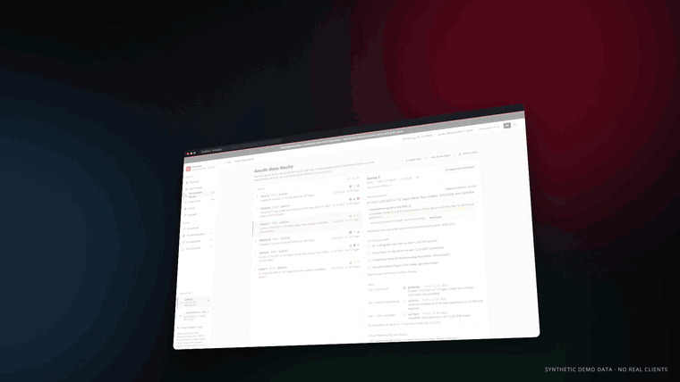</p>

The Asylsozialdienst is paid only when refugees reach integration goals before deadlines. This tool reads the Excel exports of their case-management system (as they come: German headers, Swiss dates), computes each client's status with a tested rules engine, shows a weekly call list per social worker, and writes Excel files back. A **local** AI model (Ollama) reads the free-text *Situationsanalyse* and proposes fields with the exact sentence as evidence; a person confirms. **Rules set the traffic lights, AI only extracts, people decide. Nothing leaves the computer.**

## See it

| Who to call this week, and why | Local AI reads every intake report | Ask the cockpit |
|---|---|---|
|  | 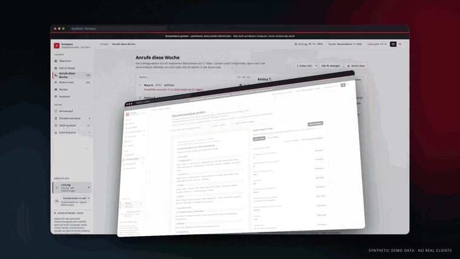 | 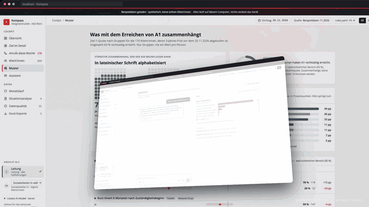 |

The GIFs are cut from the 78-second pitch video (Qwen3-TTS voice), rendered locally to `video/out/Kompass_pitch_qwen.mp4` (not in git; rebuild with the scripts in `video/`).

<details>
<summary><b>Screenshots</b></summary>

| | |
|---|---|
| **Overview** – goals reached, at risk, never billed<br>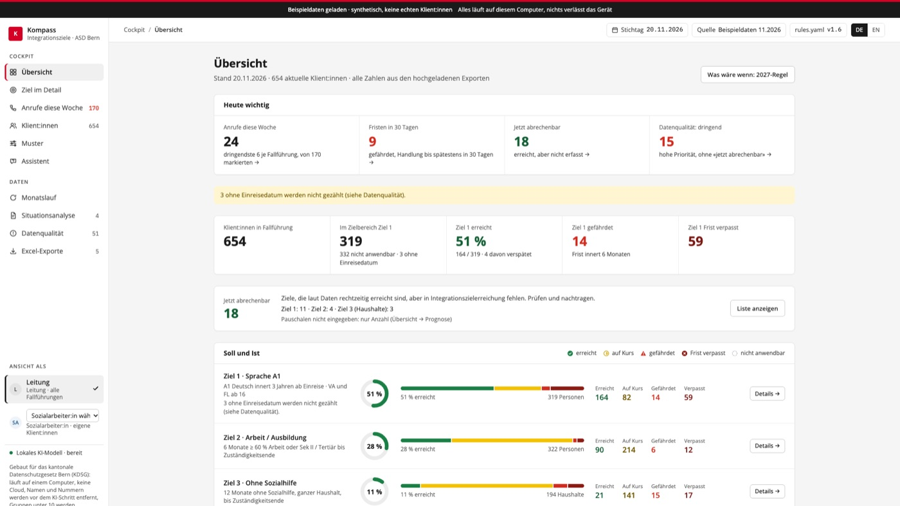 | **Monatslauf** – renamed column detected, mapping proposed<br>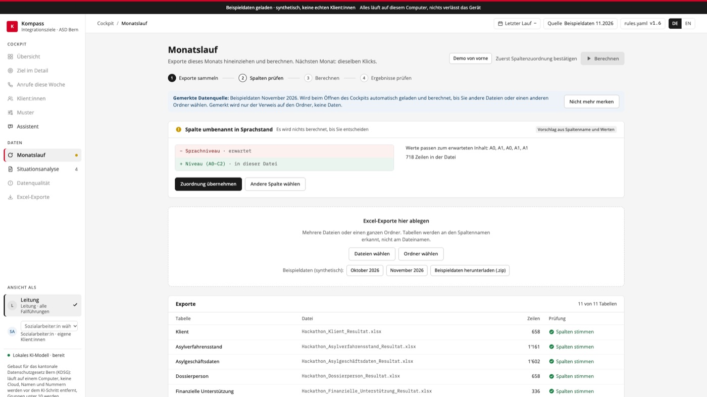 |
| **Anrufe diese Woche** – per social worker, deadline first<br>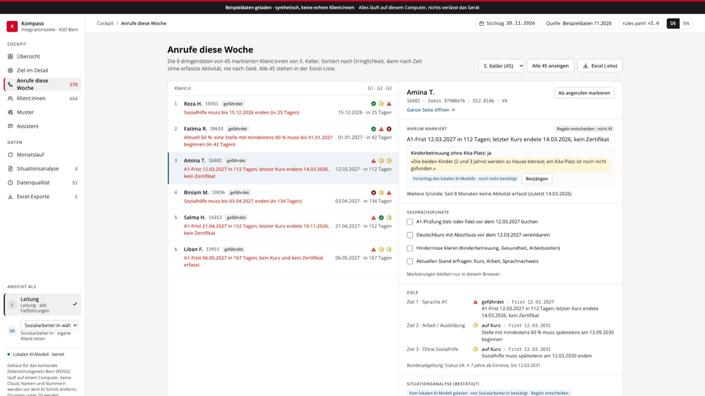 | **Client** – reason, sources (table + row), talking points<br>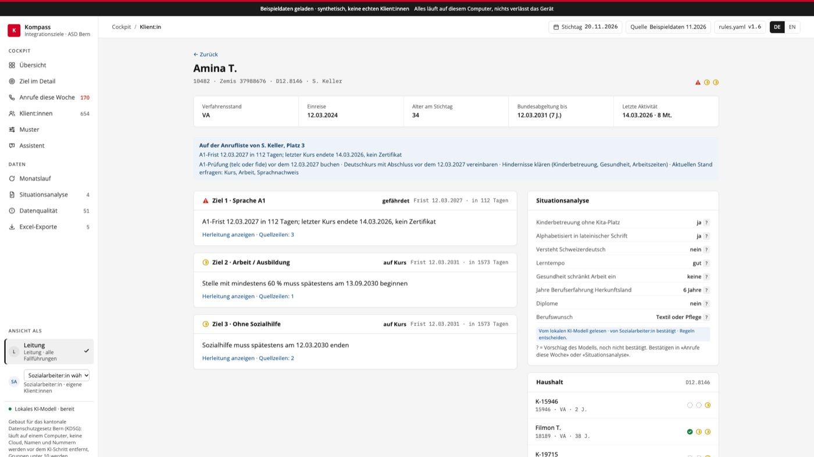 |
| **Situationsanalyse** – extracted fields with the exact sentence as evidence<br>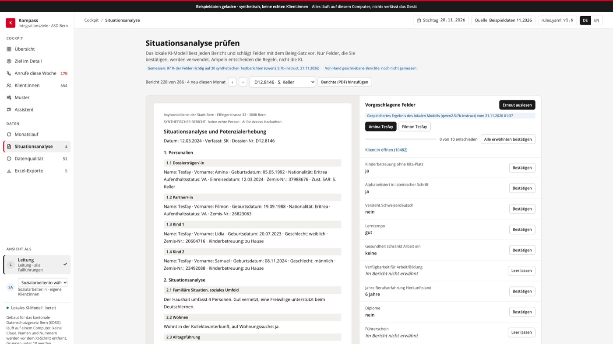 | **Muster** – patterns across the caseload<br>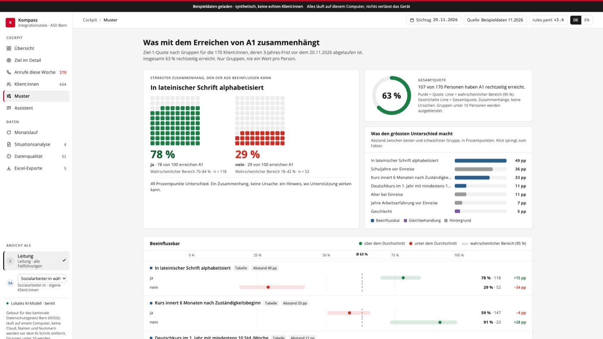 |
| **Frag das Cockpit** – answers from the rules and docs<br>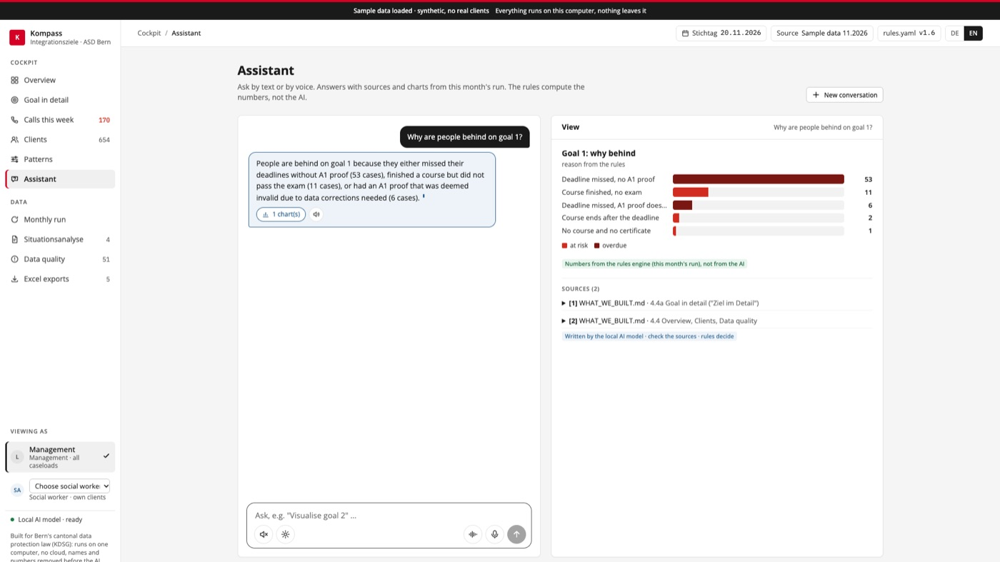 | **Excel-Exporte** – management + one workbook per social worker<br>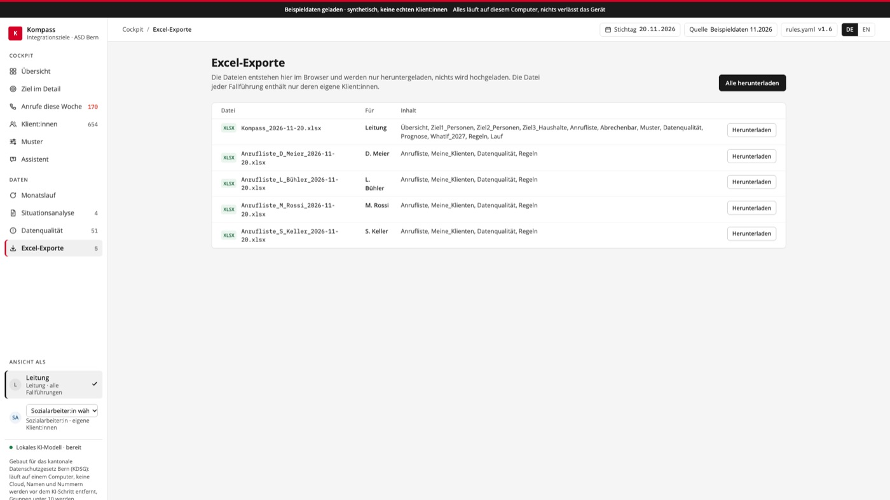 |

</details>

## Try it (judges)

1. Open the hosted demo, or run it locally (below).
2. *Monatslauf* → **November 2026** (sample data) → a renamed column is detected → **Zuordnung übernehmen** → **Berechnen**.
3. *Anrufe diese Woche* → S. Keller: Amina is first (A1 deadline in 112 days). Open her row: reason, sources (table + row), talking points.
4. *Situationsanalyse* → a report with the fields the local model extracted, evidence highlighted → **Bestätigen**.
5. *Excel-Exporte* → download the management workbook and one per social worker.
6. Or download `sample-data.zip`, change values in Excel, upload the files yourself. Every number is recomputed.

DE/EN toggle top right. *Ansicht als* switches between management and one social worker (who then sees only their own clients).

## Run locally

```bash
npm install
npm run dev            # http://localhost:5173
npm test               # rules engine acceptance tests (Vitest)
```

Or with Docker (same image as the hosted demo):

```bash
docker build -t kompass .
docker run --rm -p 8080:8080 kompass   # http://localhost:8080
```

Local AI (optional, for live extraction):

```bash
ollama pull qwen2.5:7b-instruct
ollama pull nomic-embed-text   # local search for "Frag das Cockpit"
ollama serve           # the app calls http://localhost:11434 only
```

"Frag das Cockpit" (local RAG over the brief, rules.yaml, `docs/HILFE.md` and `docs/WHAT_WE_BUILT.md`): rebuild the index after changing those files with `npm run rag`.

Optional cloud voice (ElevenLabs) for reading answers aloud: put `ELEVENLABS_API_KEY=...` in `.env.local` (git-ignored, never bundled; only the local dev/preview server reads it and calls ElevenLabs through `/api/tts`). Without it, the computer's own offline voice is used.

Regenerate the synthetic data (deterministic): `npm run data`. Measure extraction accuracy: `npx tsx scripts/extract.ts accuracy 20`.

## Deploy to Heroku (Docker)

The `Dockerfile` builds the app and serves it with `vite preview` on `$PORT`. Build for `linux/amd64` (needed on Apple Silicon) and push to Heroku's container registry:

```bash
heroku login && heroku container:login
heroku create kompass-demo --stack container      # once; pick any free app name
docker buildx build --platform linux/amd64 -t registry.heroku.com/kompass-demo/web --push .
heroku container:release web -a kompass-demo
heroku open -a kompass-demo
```

Optional: `heroku config:set ELEVENLABS_API_KEY=... -a kompass-demo` enables the cloud voice; without it the browser's own voice is used. The local AI (Ollama) still only runs on the viewer's own computer. `heroku.yml` also allows `git push heroku master` builds, but then `sample-data.zip` (git-ignored) is missing, so pushing the image from your machine is preferred.

## What is where

| Path | What |
|---|---|
| `src/config/rules.default.yaml` | every rule parameter and open assumption (shown in the app's Rules panel and the `Regeln` sheet) |
| `src/engine/` | pure TypeScript rules engine: import + table detection by headers, population, goal 1, call list, totals, data quality |
| `src/engine/import/signatures.ts` | all export header names in one place (all 11 match ASD's templates in `templates/`) |
| `src/excel/write.ts` | management + per-social-worker workbooks |
| `src/ai/extract.ts` | local-model extraction; evidence is a numbered sentence, so it is always verbatim |
| `scripts/generate.ts`, `scripts/reports.ts` | synthetic exports (2 months) and Situationsanalyse reports, with 6 planted personas |
| `tests/` | acceptance tests from the spec (TI, TS, T1, TC, TE) |

## Data protection

Built for Bern's cantonal data protection law (KDSG): runs on one computer, no cloud, names and numbers removed before the AI step, groups under 10 hidden.

Runs entirely in the browser. A Content-Security-Policy blocks every network request except the app itself and the local model on `localhost:11434`. Fonts are bundled. Browser storage holds only column mappings, call marks, confirmed report fields and the language; *Lokale Daten löschen* clears it. No per-person scores or predictions.

MIT licence.
